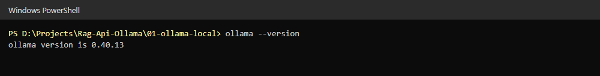
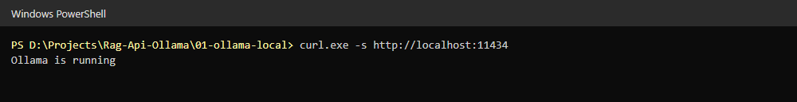
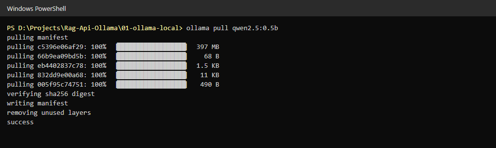
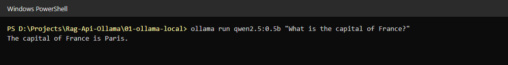
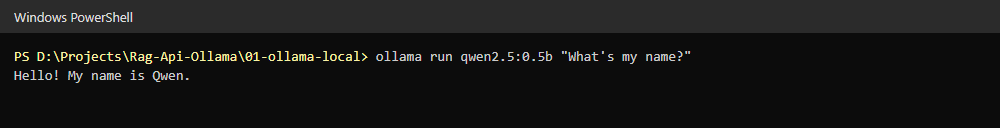
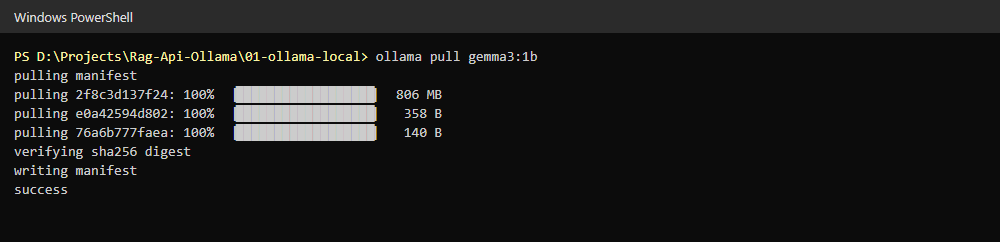
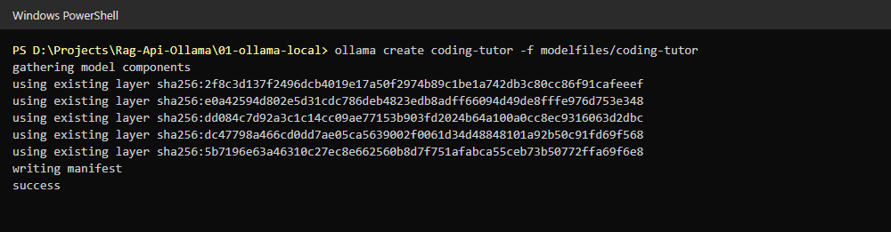
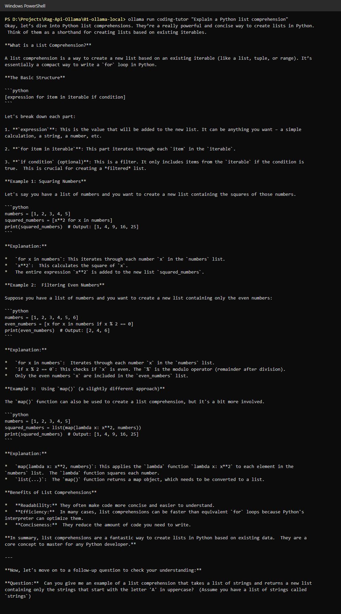
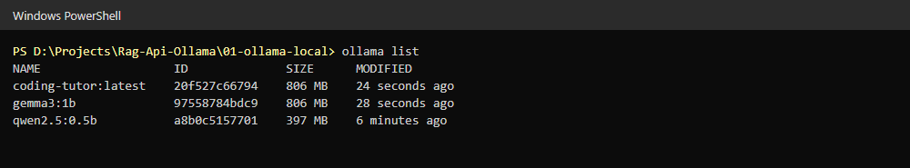

# Part 1 screenshots: run a model locally with Ollama

## 1. Check the Ollama version
`ollama --version` shows Ollama is installed.

## 2. Check the Ollama server
`curl http://localhost:11434` returns "Ollama is running".

## 3. Pull qwen2.5:0.5b
Download the small Qwen 2.5 chat model.

## 4. Ask a general question
The model answers "What is the capital of France?" correctly.

## 5. Ask a personal question
The model has no context about me, so it cannot know my name.

## 6. Pull gemma3:1b
Download the base model for the custom tutor.

## 7. Create the coding-tutor model
Build a custom model from `modelfiles/coding-tutor` (system prompt + temperature).

## 8. Run the coding-tutor model
The tutor explains list comprehensions step by step and ends with a follow-up question.

## 9. List local models
`ollama list` shows qwen2.5:0.5b, gemma3:1b and coding-tutor.

